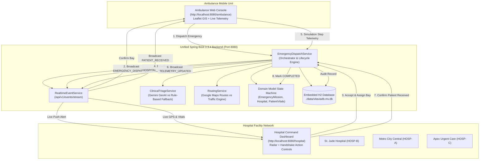

# 🚑 VITAVIA: Unified Java Emergency Response & Hospital Command Platform

**VitaVia** is an enterprise emergency-response management platform engineered with **Java 21**, **Spring Boot 3.3.4**, **Spring Data JPA**, and **Vanilla HTML/CSS/JS Dashboards**. It connects active ambulances, simulated IoT medical telemetry, AI clinical decision support, and dynamic traffic-aware routing with hospital control rooms in a real-time, closed-loop emergency workflow.

> [!NOTE]
> **Preservation Notice**: All legacy Python files (`backend/`, `frontend/`, `hospital/`, and `ambulance/`) have been preserved in this repository for reference and comparative analysis.

---

## 🌟 Key Features

1. **Unified Single-Backend Architecture**: Replaces previous detached micro-backends with a single Spring Boot server running on port `8080`, hosting both the ambulance and hospital dashboards with zero inter-process synchronization lag.
2. **Real-Time Server-Sent Events (SSE)**: Streams telemetry, status changes, and hospital handshake confirmations instantly via `/api/v1/events/stream`.
3. **Four Core Java OOP Concepts**: Implemented directly in domain models:
   - **Encapsulation**: Validated physiologic invariants in `PatientVitals`, `GeoPoint`, and `EmergencyMission`.
   - **Abstraction**: Abstract `MedicalResource` base class, `RoutingEngine` and `TriageAssessor` interfaces.
   - **Inheritance**: Specialized `BedResource`, `VentilatorResource`, and `SpecialistStaffResource`.
   - **Polymorphism**: Dynamic method overriding (`allocate()`, `release()`) and Strategy pattern for AI triage and routing engines.
4. **Closed-Loop Hospital Handshake**:
   - Ambulance dispatches patient -> Hospital receives real-time alert -> Hospital staff clicks **"ACCEPT & PREPARE BAY"** -> Ambulance advances transit with live GPS and vitals drift -> Ambulance arrives -> Hospital staff clicks **"PATIENT RECEIVED (ADMIT)"** -> State transitions to `COMPLETED` and persists to relational database.
5. **Dynamic Hospital Rejection & Rerouting**: If an inbound hospital is saturated and diverts the ambulance, the system dynamically recalculates routes and reroutes to the next fastest eligible hospital without dropping the mission.
6. **Persistent Relational Database**: Uses an embedded H2 database (`jdbc:h2:file:./data/vitaviadb`) so emergency mission history, vital logs, and admission audit trails survive server restarts.

---

## 🏗️ System Architecture



---

## 🖥️ Dashboards & Access URLs

Once the application is running, open your web browser to:

| Dashboard / Interface | URL | Description |
| :--- | :--- | :--- |
| **Ambulance Control Dashboard** | [`http://localhost:8080/ambulance`](http://localhost:8080/ambulance) *(or `/`)* | Emergency scenario picker, live vitals monitors, Leaflet route map, transit simulator controls (`+10% Step`, `Auto Stream`). |
| **Hospital Command Console** | [`http://localhost:8080/hospital`](http://localhost:8080/hospital) | Active facility switcher, real-time inbound alert banner, interactive action buttons (**"ACCEPT & PREPARE"**, **"PATIENT RECEIVED"**, **"DIVERT / CANNOT ACCEPT"**), live geographic radar, capacity toggles, admission audit trail. |
| **H2 Database Web Console** | [`http://localhost:8080/h2-console`](http://localhost:8080/h2-console) | Interactive SQL browser. **JDBC URL**: `jdbc:h2:file:./data/vitaviadb` (or `jdbc:h2:mem:vitaviadb`), **User**: `sa`, **Password**: *(blank)*. |
| **Backend Health Check** | [`http://localhost:8080/health`](http://localhost:8080/health) | Returns JSON status of backend services, database, and AI mode. |

---

## 🚀 Quick Start (Build & Run)

### Prerequisites
- **JDK**: Java 21 or later installed (e.g. Oracle OpenJDK or Eclipse Temurin).
- **Environment**: Windows, macOS, or Linux. No external Maven installation required (Maven Wrapper is included).

### 1. Run the Java Application
Open your terminal in the project root directory and run:

```powershell
# On Windows (PowerShell / Command Prompt):
.\mvnw.cmd spring-boot:run

# On Linux / macOS:
./mvnw spring-boot:run
```

The application will compile and start Tomcat on port `8080`.

### 2. Run the Automated Test Suite
To execute all 14 unit, integration, and edge-case tests:

```powershell
# On Windows:
.\mvnw.cmd test

# On Linux / macOS:
./mvnw test
```

Expected output:
```text
[INFO] Running com.vitavia.OOPConceptsVerificationTest
[INFO] Tests run: 6, Failures: 0, Errors: 0, Skipped: 0
[INFO] Running com.vitavia.StageDEdgeCasesTest
[INFO] Tests run: 5, Failures: 0, Errors: 0, Skipped: 0
[INFO] Running com.vitavia.VitaViaIntegrationWorkflowTest
[INFO] Tests run: 3, Failures: 0, Errors: 0, Skipped: 0
[INFO] Results:
[INFO] Tests run: 14, Failures: 0, Errors: 0, Skipped: 0
[INFO] BUILD SUCCESS
```

---

## ⚙️ Environment Variables (Optional)

The application includes built-in heuristic clinical evaluation rules and urban traffic simulation engines, meaning **no API keys are required** to test all workflows. If you wish to enable live external APIs:

| Variable | Description | Default Fallback |
| :--- | :--- | :--- |
| `GEMINI_API_KEY` | Google Gemini AI API key for clinical triage assessment. | Rule-based clinical heuristic triage engine (`HEURISTIC_FALLBACK`). |
| `GOOGLE_MAPS_API_KEY` | Google Routes API key for real-world traffic routing. | High-fidelity local mock traffic routing engine (`MOCK_TRAFFIC_ENGINE`). |
| `SPRING_DATASOURCE_URL` | Override the database connection string. | `jdbc:h2:file:./data/vitaviadb;AUTO_SERVER=TRUE;DB_CLOSE_DELAY=-1` |

#### Example (PowerShell):
```powershell
$env:GEMINI_API_KEY="AIzaSyYourGeminiApiKeyHere"
$env:GOOGLE_MAPS_API_KEY="AIzaSyYourGoogleMapsKeyHere"
.\mvnw.cmd spring-boot:run
```

---

## 🧩 The Four Java OOP Concepts in VitaVia

### 1. Encapsulation
- **`PatientVitals.java`**: Immutably encapsulates medical parameters (`spo2`, `heartRate`, `systolicBp`, `diastolicBp`, `temperature`). Constructor validates strict physiological boundaries (e.g. $0 \le SpO_2 \le 100\%$), throwing `IllegalArgumentException` on impossible readings. Methods like `calculateMeanArterialPressure()` and `isInShock()` compute derived clinical values internally.
- **`EmergencyMission.java`**: Acts as the domain aggregate root. Internal state (`status`, `currentLocation`, `currentEtaMinutes`) is private, and transitions are guarded by a state machine preventing illegal jumps.

### 2. Abstraction
- **`MedicalResource.java`**: Abstract base class declaring the contract for medical infrastructure (`allocate()`, `release()`, `getResourceType()`). Clients allocate and release hospital resources without knowing underlying hardware or ward mechanics.
- **`RoutingEngine.java` & `TriageAssessor.java`**: Pure strategy interfaces hiding low-level network and API details. The core dispatch engine interacts with `calculateRoute(...)` and `assess(...)` polymorphically.

### 3. Inheritance
- Specialized subclasses extend `MedicalResource`:
  - **`BedResource`**: Inherits common resource logic and specializes into ward types (`ICU`, `TRAUMA_BAY`, `EMERGENCY_BED`).
  - **`VentilatorResource`**: Inherits common resource logic and adds ventilator model types and invasive/non-invasive oxygenation settings.
  - **`SpecialistStaffResource`**: Inherits capacity tracking and models emergency physicians and trauma surgeons on duty.

### 4. Polymorphism
- **Dynamic Resource Allocation**: Collections of heterogeneous `MedicalResource` instances in `Hospital.java` are allocated and released via dynamic method dispatch (`resource.allocate()`).
- **Strategy Pattern Polymorphism**:
  - `RoutingEngine` interface implemented by `GoogleMapsRoutingEngine` and `MockTrafficRoutingEngine`.
  - `TriageAssessor` interface implemented by `GeminiClinicalTriageAssessor` and `RuleBasedHeuristicTriageAssessor`.

---

## 🗄️ Database Persistence: In-Memory vs File-Backed

### In-Memory (`jdbc:h2:mem:...`)
- **Pros**: Fast, zero cleanup needed.
- **Cons**: All mission history, patient records, and telemetry logs are deleted when the JVM stops.

### File-Backed (`jdbc:h2:file:./data/vitaviadb`) *(VitaVia Default)*
- **Pros**: Data persists across application restarts in `./data/vitaviadb.mv.db`. Historical admissions and telemetry traces remain accessible in subsequent sessions.
- **`AUTO_SERVER=TRUE`**: Enables concurrent connection from both the Spring Boot app and external tools (like the H2 web console) without file-lock collisions.
- **Test Isolation**: Automated tests execute against an isolated in-memory test database (`jdbc:h2:mem:vitaviadb_test`) so tests never overwrite production data.

---

## 📡 REST API Reference

| Method | Endpoint | Description |
| :--- | :--- | :--- |
| `GET` | `/health` | Application status, database mode, and active AI assessor. |
| `GET` | `/api/v1/hospitals` | Catalog of registered hospitals, coordinates, and real-time capacities. |
| `GET` | `/api/v1/hospitals/{id}` | Real-time capacity details for a specific hospital. |
| `PUT` | `/api/v1/hospitals/{id}` | Update hospital bed, ICU, and ventilator capacity. |
| `POST` | `/api/v1/hospitals/reset` | Reset all hospital capacities to default values. |
| `POST` | `/api/v1/dispatch` | Evaluates patient vitals, selects fastest eligible hospital, and creates emergency mission. |
| `POST` | `/api/v1/recommend-hospital` | Preview hospital routing and triage recommendations without dispatching. |
| `POST` | `/api/v1/analyze-vitals` | Clinical triage analysis returning urgency, required infra, and clinical summary. |
| `GET` | `/api/v1/emergency/incoming` | Fetch latest active incoming emergency alert for a hospital console. |
| `POST` | `/api/v1/emergencies/{id}/acknowledge` | Hospital staff accepts patient and assigns trauma bay. |
| `POST` | `/api/v1/emergencies/{id}/reject` | Hospital diverts incoming ambulance; system dynamically reroutes to next best hospital. |
| `POST` | `/api/v1/emergencies/{id}/complete` | Hospital confirms patient received; completes emergency lifecycle. |
| `GET` | `/api/v1/simulation/snapshot` | Current mission snapshot (coordinates, progress, vitals, ETA). |
| `POST` | `/api/v1/simulation/step` | Advance transit progress and apply physiologic vital variations. |
| `GET` | `/api/v1/history/emergencies` | List recent emergency missions with status and hospital assignments. |
| `GET` | `/api/v1/history/emergencies/{id}` | Detailed emergency audit record with full vital readings and GPS trace timeline. |
| `GET` | `/api/v1/events/stream` | Server-Sent Events (SSE) live data stream for connected dashboards. |
